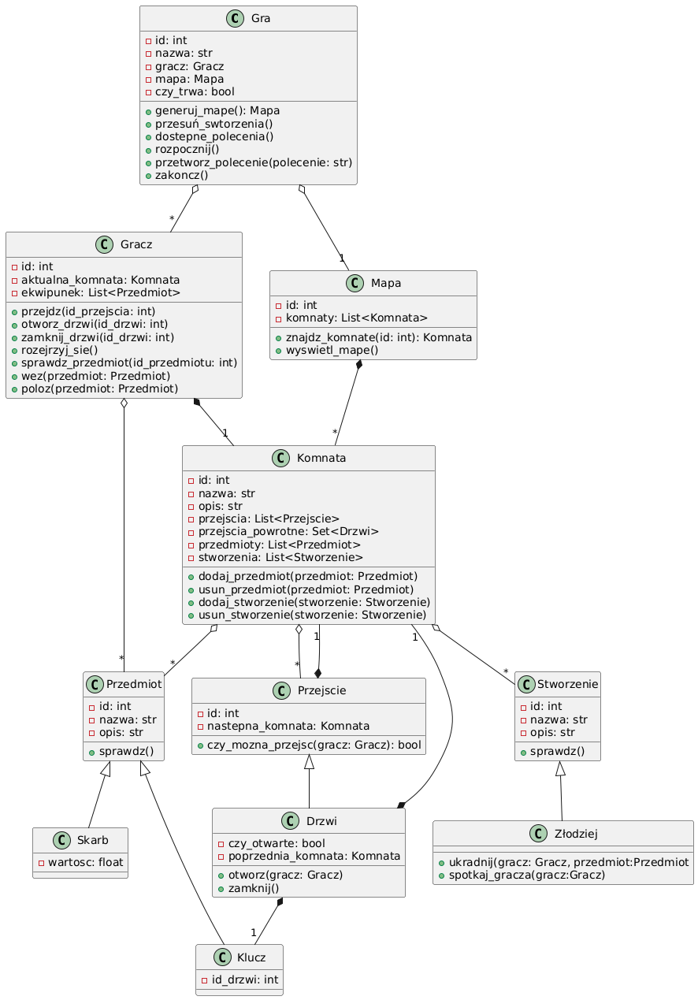
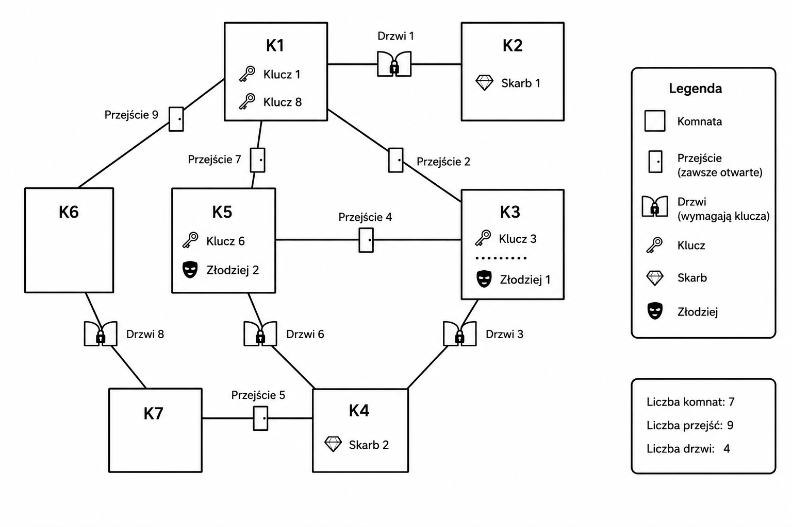

# Maze Exploration Game in Python

## Opis projektu

Projekt przedstawia tekstową grę przygodową napisaną w Pythonie z wykorzystaniem programowania obiektowego.

Gracz eksploruje labirynt składający się z połączonych komnat, zbiera klucze i skarby, otwiera zamknięte drzwi oraz unika złodziei przemieszczających się po mapie.

Projekt został wykonany jako praca końcowa w ramach przedmiotu **Programowanie 2 w języku Python**.

## Najważniejsze elementy gry

- eksploracja labiryntu,
- poruszanie się między komnatami,
- zbieranie kluczy i skarbów,
- otwieranie zamkniętych drzwi,
- ekwipunek gracza,
- losowo poruszający się złodzieje,
- tekstowy system poleceń.

## Diagram UML

## Mapa labiryntu

## Programowanie obiektowe

Wykorzystano:

- dziedziczenie,
- polimorfizm,
- kompozycję,
- agregację,
- podział programu na klasy.

Najważniejsze klasy projektu:

- `Gra`
- `Gracz`
- `Mapa`
- `Komnata`
- `Przejście`
- `Drzwi`
- `Przedmiot`
- `Klucz`
- `Skarb`
- `Stworzenie`
- `Złodziej`

## Testy jednostkowe

Projekt zawiera testy jednostkowe przygotowane z wykorzystaniem biblioteki `unittest`, które sprawdzają najważniejsze elementy logiki gry.

